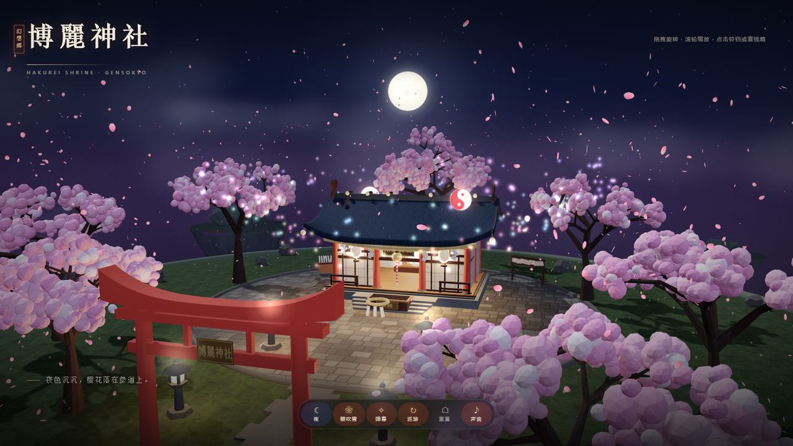
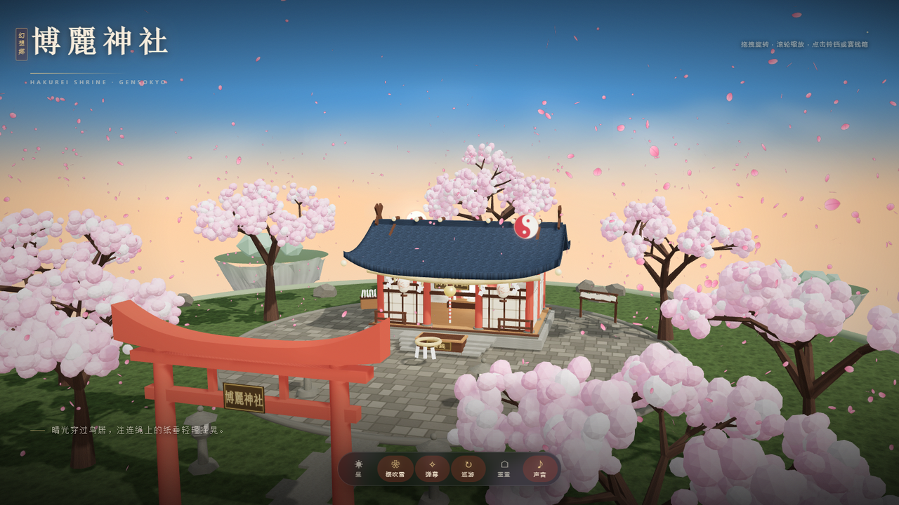
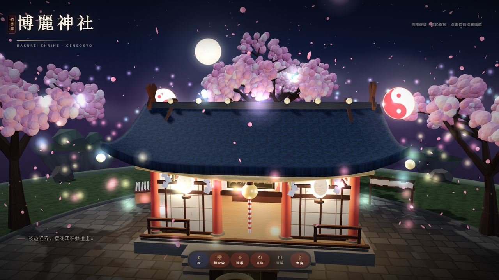

# 博麗神社 · 3D

> 东方 Project 非官方同人演示 · Three.js 单文件 WebGL 场景

浮在云海上的博丽神社：夜色、樱花、鸟居、石灯笼、注连绳、铃与赛钱箱、绕社旋转的阴阳玉，以及白天与黑夜两套完整配色。

**在线试玩**：https://nlzdyqwq.github.io/BoLiShenSheYanShihtml/ （GitHub Pages，加载后即自动开场）

**下载 [index.html](index.html) 双击即可离线运行**，无需服务器、无外部资源、无需联网。

## 操作

| 操作 | 说明 |
| --- | --- |
| 拖拽 | 旋转视角 |
| 滚轮 / 双指捏合 | 推近拉远 |
| 点击铃铛 | 摇铃，合成铃声 + 金色粒子 |
| 点击赛钱箱 | 奉纳音效 + 提示 |
| `N` | 昼夜切换 |
| `P` | 樱吹雪开/关 |
| `D` | 弹幕开/关 |
| `空格` | 自动巡游 |
| `R` | 重置视角 |

底部工具栏包含：昼夜 / 樱吹雪 / 弹幕 / 巡游 / 重置 / 声音。

## 场景

- 浮空岛：噪声岩石、草皮、石板广场与参道、远处小浮岛与云海
- 拜殿：曲面起翘屋顶、千木与坚鱼木、朱红柱、障子、注连绳与纸垂、奉纳额、铃、赛钱箱、神镜祭坛、绘马架、御神签架
- 红色明神鸟居（曲线笠木 + 匾额）与石鸟居
- 7 棵程序化樱花树、900 片飘落花瓣
- 阴阳玉、萤火、220 发弹幕、星空与月亮
- 昼夜调色板平滑过渡（天空、雾、月光、灯笼、云色、曝光）

## 技术

- Three.js r150（UMD）单文件内联，Canvas 程序化生成全部贴图
- 约 47 万三角形 / 350 draw call，PCF 软阴影 + ACES 色调映射
- 无后处理管线，光晕由加色 Sprite 伪造
- 支持 `prefers-reduced-motion`；WebGL 不可用时显示提示页

## 预览

## 说明

- 东方 Project 及博丽神社相关设定版权归 ZUN / 上海爱丽丝幻乐团所有，本项目为兴趣向非官方演示。
- 演示代码可自由参考；若转载图片或页面，请注明出处。
